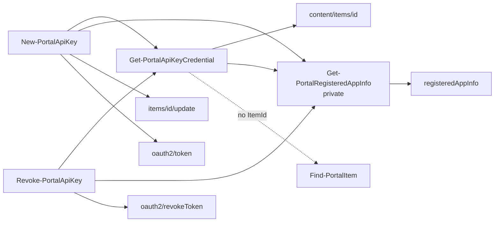

# API key management: design

## Approach

Three public functions wrap the four Portal calls verified live on ArcGIS Enterprise 11.5. They read the credentials item and its `registeredAppInfo`, set a slot's expiration on the item, generate a key with `oauth2/token`, and invalidate a slot with `oauth2/revokeToken`. One private helper fetches `registeredAppInfo`, the only response containing `client_secret`, so the secret never leaves module-internal code.

## Verified REST contract (11.5)

| Step | Request | Notes |
| --- | --- | --- |
| Item | `POST sharing/rest/content/items/{id}` | `type = Application`, `typeKeywords` contains `APIToken`; `apiToken1ExpirationDate` / `apiToken2ExpirationDate` are Int64 epoch ms, `-1` when never set. |
| App info | `POST sharing/rest/content/users/{owner}/items/{id}/registeredAppInfo` | `client_id`, `client_secret`, `apiToken1Active`, `apiToken2Active`, `privileges`, `httpReferrers`. |
| List | `sharing/rest/search` via `Find-PortalItem -Owner -Type 'Application'`, then filter on `APIToken` | |
| Set expiration | `POST sharing/rest/content/users/{owner}/items/{id}/update` with `apiToken{N}ExpirationDate` | Must happen before generating; the key's `expires_in` follows it. |
| Generate | `POST sharing/rest/oauth2/token`: `client_id`, `client_secret`, `grant_type=client_credentials`, `apiToken={N}`, `regenerateApiToken=true` | Returns `access_token` (the key, 252 chars) and `expires_in`. The slot digit is at index `length - 10`. |
| Revoke | `POST sharing/rest/oauth2/revokeToken` with the same body | Returns `{ success: true }`; the key then gets `498`. |

An administrator token works for every step on credentials owned by another user. An inactive slot keeps its last expiration, and writing `-1` does not clear it, so `apiToken{N}Active` is the only reliable "in use" signal.

## Components

### Get-PortalApiKeyCredential

- Parameters: `-ItemId` (optional, `[a-f0-9]{32}`, `ValueFromPipelineByPropertyName`), `-UserName` (optional), `-Context`, `-Token`, `-SkipCertificateCheck`.
- With `-ItemId`, it reads the item, errors if it is not `Application` with `APIToken`, and uses `-UserName` or the item owner for `registeredAppInfo`.
- Without `-ItemId`, it resolves `-UserName` (default: `Resolve-PortalUserName`), lists that user's `Application` items with `APIToken`, and returns one object per item.
- Output: `[PSCustomObject]` with PSTypeName `ArcGISEnterprise.ApiKeyCredential`:
  - `ItemId`, `Title`, `Owner`, `ClientId`, `Privileges`, `HttpReferrers`
  - `Slot1Active`, `Slot1Expires`, `Slot2Active`, `Slot2Expires`

  `SlotNExpires` is `ConvertFrom-Epoch` of the item value when the slot is active and the value is greater than 0; otherwise `$null`.

### New-PortalApiKey

- Parameters:
  - `-ItemId` (mandatory, by property name)
  - `-Slot` (mandatory, `[ValidateSet(1, 2)]`)
  - `-Expiration` (mandatory, `System.DateTime`)
  - `-UserName`, `-Context`, `-Token`, `-SkipCertificateCheck`
- `[CmdletBinding(SupportsShouldProcess, ConfirmImpact = 'High')]`, so it always confirms. Automation passes `-Confirm:$false`.
- Steps:
  1. Validate `-Expiration`: it must be in the future and no more than one year out. Fail with `Write-Error -ErrorAction Stop` before any request.
  2. Read the current state with `Get-PortalApiKeyCredential`. If the slot is active, the `ShouldProcess` message says the existing key in that slot will stop working.
  3. Set `apiToken{N}ExpirationDate` with `[System.DateTimeOffset]::new($Expiration).ToUnixTimeMilliseconds()`.
  4. Call `oauth2/token` and check that the key's slot digit equals `-Slot`; otherwise write an error.
  5. Return a `[PSCustomObject]` with PSTypeName `ArcGISEnterprise.ApiKey`: `ItemId`, `Slot`, `Expires` (`System.DateTime`), `ApiKey` (`System.Security.SecureString`).
- A `Clean` block removes the plain-text key and the client values with `Remove-Variable -Force -ErrorAction Ignore`.

### Revoke-PortalApiKey

- Parameters: `-ItemId` (mandatory, by property name), `-Slot` (mandatory, `[ValidateSet(1, 2)]`), `-UserName`, `-Context`, `-Token`, `-SkipCertificateCheck`.
- `ConfirmImpact = 'High'`. If the slot is not active, it writes a warning and makes no request.
- It calls `oauth2/revokeToken`. It writes an error if `success` is not `true`, and produces no output.

### Get-PortalRegisteredAppInfo (private)

- Wraps `registeredAppInfo` and returns the raw response, including `client_secret`, to module callers only.
- It converts an ArcGIS `error` body into a terminating error.

## Affected files

- New: `Public/Get-PortalApiKeyCredential.ps1`, `Public/New-PortalApiKey.ps1`, `Public/Revoke-PortalApiKey.ps1`, `Private/Get-PortalRegisteredAppInfo.ps1`
- New: `Tests/Unit/Get-PortalApiKeyCredential.tests.ps1`, `Tests/Unit/New-PortalApiKey.tests.ps1`, `Tests/Unit/Revoke-PortalApiKey.tests.ps1`
- New (generated): `Documentation/Get-PortalApiKeyCredential.md`, `Documentation/New-PortalApiKey.md`, `Documentation/Revoke-PortalApiKey.md`
- Changed:
  - `ArcGISEnterprise.psd1`: add three `FunctionsToExport` entries; `ModuleVersion` 2.3.1 to 2.4.0 (minor: new functions)
  - `Documentation/index.md`: function-to-endpoint rows
  - `README.md`: short rotation example under "Use an API key"

## Alternatives considered

- **One `Invoke-PortalApiKeyRotation` command:** rejected. Rotation has a deployment step between generate and revoke, and a single command would revoke before the new key is deployed.
- **Return a `PSCredential` with a placeholder username:** rejected. The username has no meaning, and the object invites passing the key to a cmdlet that expects a login. A `SecureString` property on an object that carries `Slot` and `Expires` gives the same protection plus the metadata rotation needs.
- **Prompt only when the slot is active** (`ConfirmImpact = 'Medium'` plus `ShouldContinue` and `-Force`): possible, but adds a `-Force` switch and a second confirmation path. Always confirming keeps one path; Lambda already needs `-Confirm:$false`.
- **Expose `client_secret` from `Get-PortalApiKeyCredential`:** rejected for security; the private helper is the only place it exists.

## Risks and tradeoffs

- **Secret exposure (Security).**
  - `client_secret` and the new key are sent only in POST bodies, never in URLs or `Write-Verbose`.
  - Output contains only a `SecureString`. Tests serialize every output object and assert that the secret strings are absent.
- **Undocumented token parameters.** `apiToken` and `regenerateApiToken` on `oauth2/token` and `revokeToken` come from Esri's REST JS source, not the REST API reference. They were verified on 11.5 only. Mitigation: record the contract in repo memory and in each function's `.NOTES`, and check the slot digit after generating.
- **Expiration change and the other slot.** Esri documents that editing the credentials' expiration invalidates all keys. Setting a slot's `apiToken{N}ExpirationDate` is narrower than that. Verified 2026-10-21: after setting slot 2's expiration, then generating and revoking a slot 2 key, the existing slot 1 key still authenticated (`portals/self` returned its `appInfo.appId`).
- **Stale expiration on inactive slots.** Handled by reporting `$null` unless the slot is active.
- **Always confirming (Operational Excellence vs. convenience).** Interactive users get a prompt even for an empty slot; the gain is one predictable confirmation path.

## ADR check

No cross-cutting decision; everything here is local to these functions.
